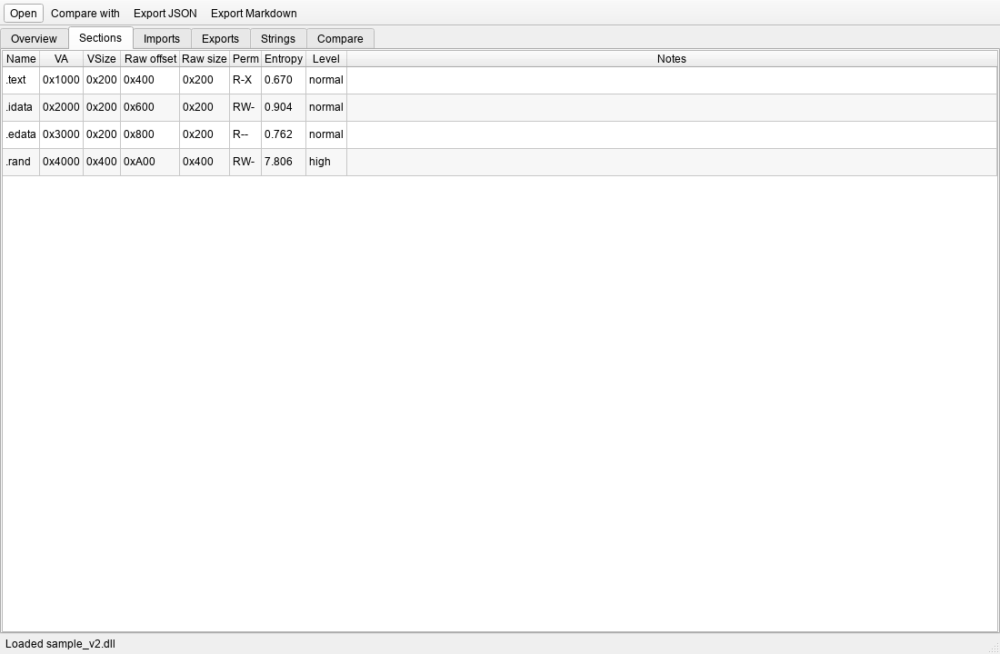
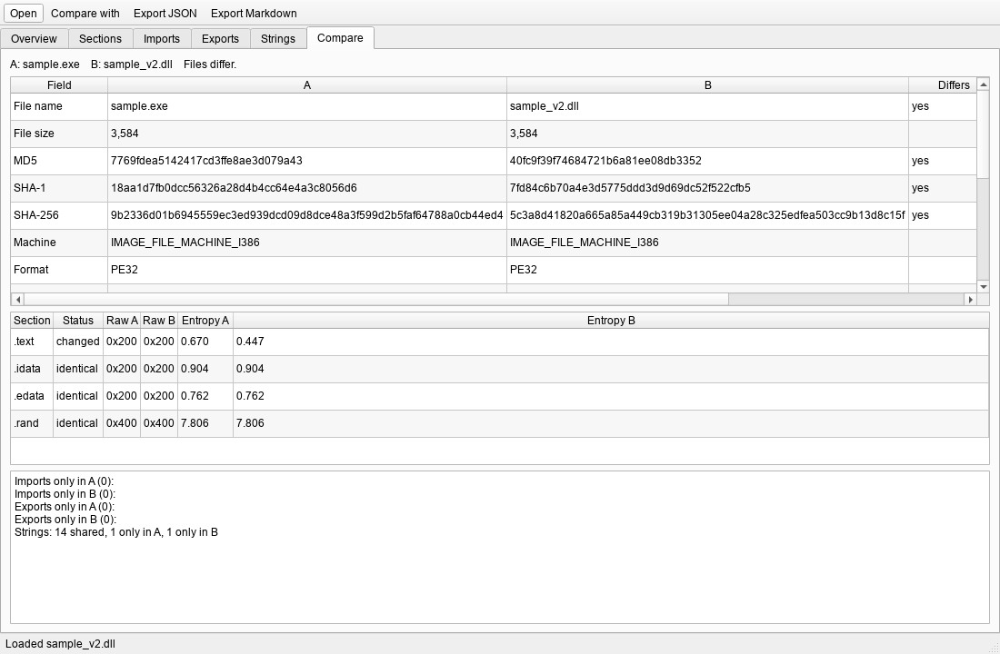

# PE Inspector

Small tool for looking at Windows PE files (.exe / .dll) without running them. There's a PySide6
GUI and a command-line mode. It shows hashes, headers, sections with entropy, imports, exports,
the entry point and strings, and can diff two files. Reports export to JSON or Markdown.




The screenshots are made from synthetic PE files by `scripts/make_screenshot.py`.

## Install

Windows, Python 3.10+ (I use 3.14; CI runs 3.12):

```bat
git clone <this repo> pe-inspector
cd pe-inspector
python -m venv .venv
.venv\Scripts\activate
python -m pip install -e ".[dev]"
```

## Usage

GUI: drop a file on the window or press Ctrl+O. Ctrl+Shift+O loads a second file to compare.

```bat
python -m pe_inspector
python -m pe_inspector a.exe b.exe
```

CLI:

```bat
pe-inspector some.exe
pe-inspector some.exe --format json -o report.json
pe-inspector old.dll --compare new.dll --format markdown -o diff.md
```

`-o` won't overwrite an existing file unless you pass `--force`, and it never overwrites the
input files. Exit code is 0 on success, 2 if a file can't be read or parsed (message on stderr).

Strings are ASCII and UTF-16LE, minimum length 5, capped at 5000. In the Markdown report, text
taken from the file (strings, names) is escaped so it can't inject formatting or HTML.

## Development

```bat
python -m pytest -q
ruff check .
ruff format --check .
```

The tests build a small PE32 in code (`pe_inspector/synthetic.py`), so no binaries are committed.
One test also reads `notepad.exe` from System32 if it's there. The parsing code is in
`analysis.py`, `report.py` does compare/JSON/Markdown, and Qt only shows up under `ui/`.

## Limits

- Files are only read as bytes and parsed with pefile, never executed. pefile is third-party code
  parsing hostile input though, so don't treat a sample as safe because of this tool.
- Entropy and the warnings are hints, not a verdict.
- No resources, version info, signatures, delay-load imports, .NET metadata or Rich header.
- The whole file is loaded into memory, max 256 MiB.
- Only tried on Windows. The GUI test runs offscreen, so drag and drop and file dialogs are
  untested.

## License

MIT, see [LICENSE](LICENSE).
